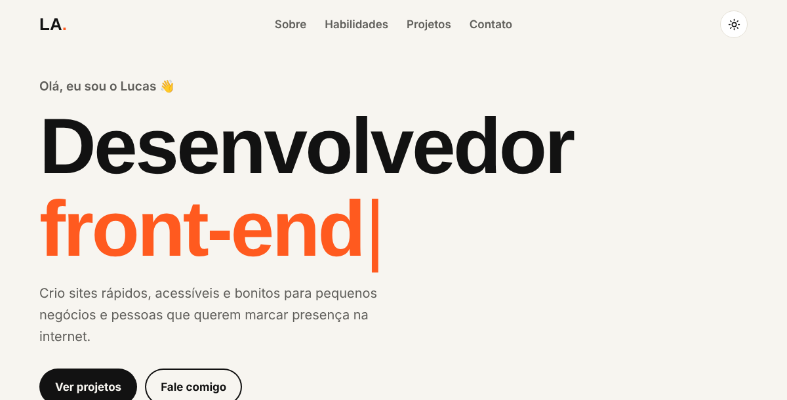

# PortfolioLite — Modelo de portfólio

Página de portfólio pessoal com apresentação, habilidades em barras de progresso, projetos em cards e formulário de contato funcional.

🔗 **[Ver o site no ar](https://iamviniciuslima05.github.io/PROJETO-PortfolioLite/)**



## Funcionalidades

- Seções de **apresentação, sobre, habilidades, projetos e contato**
- Título com **efeito de digitação**
- **Barras de habilidades** animadas ao rolar
- Projetos em **cards com filtro** por categoria
- **Formulário de contato** com validação que envia pelo **WhatsApp ou e-mail**
- **Tema claro e escuro**
- Menu responsivo e link ativo conforme a seção
- Animações que respeitam quem prefere menos movimento

## Tecnologias

HTML5 · CSS3 · JavaScript · IntersectionObserver

## Estrutura

```
index.html
css/style.css
js/script.js
```

## Como rodar

Não precisa instalar nada: baixe o projeto e abra o `index.html` no navegador, ou acesse a versão publicada acima.

> Para usar como seu portfólio, troque os textos do `index.html` e as constantes `WHATSAPP`, `EMAIL`, `HABILIDADES` e `PROJETOS` no início do `js/script.js`.

---
Feito por **Vinicius Lima** · [Portfólio](https://viniciuslimadev.netlify.app) · [LinkedIn](https://www.linkedin.com/in/viniciuslima25/)
